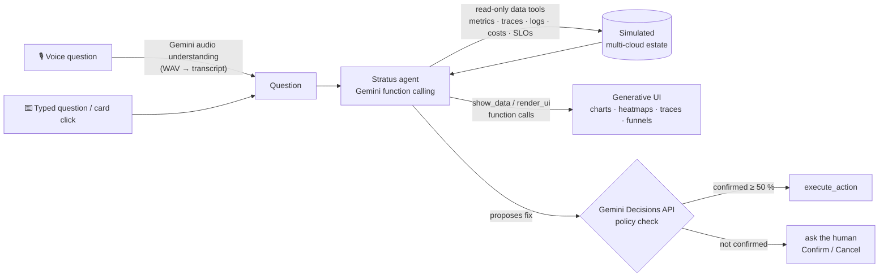

# Stratus – an AI SRE for every cloud

**Stratus** is an AI agent you can talk to (by chat or voice) about your cloud infrastructure and your business.
Ask *"Why is my checkout slow?"* or *"Where can we cut cloud costs?"* and Stratus investigates across
providers, finds the root cause, explains it with **charts it generates on the fly**, and proposes a fix
that a human approves with one click.

Built in one day at the **{Tech: Europe} Agentic AI Hack** in Karlsruhe, co-hosted by
**Google DeepMind** and **codesphere**.

> All infrastructure data is **simulated** for the demo. The agent, its tool calls, the generated UI and the
> approval flow are real.

---

## The problem

Modern shops run on several clouds at once. When checkout gets slow, the evidence is spread across
CloudWatch, Cloud Trace, Azure Monitor, deploy logs and billing exports. Finding the cause takes hours,
and the people who feel the impact (business, management) can't read any of these dashboards.

## What Stratus does

1. **Overview first.** A start page shows open incidents and savings opportunities across all providers at a glance.
2. **Investigates like an SRE.** The agent plans its investigation and calls tools for metrics, traces, logs,
   deploys, funnel data, SLOs and costs, in parallel when it makes sense. Every tool call is visible as a step.
3. **Answers visually (generative UI).** Instead of walls of text, the agent builds the answer from UI
   components: a concise *What / Impact / Cause / Fix* breakdown, then evidence such as a latency heatmap by
   region, a trace waterfall, a conversion funnel, an incident timeline, SLO gauges or a revenue projection
   up to Black Friday.
4. **Human in the loop.** Fixes (rollback, scaling, rightsizing) are proposed as buttons. Nothing changes until
   a human confirms. The tools themselves are read-only.
5. **Voice.** Tap the mic, ask your question, and Gemini transcribes it.

---

## Built on Google Gemini

Gemini is not a chatbot bolted onto a dashboard. It **is** the product. Each step from your question to an
approved fix runs on a different Gemini capability:



| # | Gemini capability | Model / endpoint | What Stratus does with it | Code |
|---|---|---|---|---|
| 1 | **Function calling: the agent loop** | `generateContent` · `gemini-flash-latest` (frontend), `gemini-3.7-flash` (backend) | Gemini plans the investigation, calls up to 14 tools (often in parallel) over up to 10 turns, keeps its thought signatures across turns and reasons its way to the root cause | [`lib/agent/gemini/gemini_agent.dart`](lib/agent/gemini/gemini_agent.dart), [`backend/agent.py`](backend/agent.py) |
| 2 | **Generative UI through function calls** | same agent loop | Two UI tools let Gemini decide *how* to explain: `show_data(data_id)` picks the best visualization for the data it just retrieved, and `render_ui(component_json)` composes briefs, KPI tiles, tables, action buttons and follow-up questions | [`lib/agent/gemini/prompt.dart`](lib/agent/gemini/prompt.dart) |
| 3 | **Gemini Decisions API** | `POST /v1beta/decisions` · `gemini-decision-1` | **Human-in-the-loop guard:** before any production change, a yes/no decision ("did the user explicitly confirm this action?") and a risk score (low / medium / high). Below 50 % confidence the action is blocked and Gemini has to ask for confirmation first. **Routing:** the offline playbook maps free-form questions to one of 16 scenarios as a `choice` decision | [`lib/gemini/decisions_client.dart`](lib/gemini/decisions_client.dart), [`lib/agent/gemini/policy.dart`](lib/agent/gemini/policy.dart), [`lib/agent/mock_router.dart`](lib/agent/mock_router.dart) |
| 4 | **Audio understanding** | `generateContent` with `audio/wav` inline data | Voice input: the browser records 16 kHz WAV, and Gemini transcribes it with a domain-aware prompt (it knows *p95*, *payment-svc*, *error budget*, …) | [`lib/voice/`](lib/voice/), [`lib/gemini/gemini_client.dart`](lib/gemini/gemini_client.dart) |
| 5 | **Structured output** | `generateContent` + `responseSchema` (enum) | Fallback router when the Decisions API is unavailable | [`lib/gemini/gemini_client.dart`](lib/gemini/gemini_client.dart) |
| 6 | **Google GenAI SDK** | `google-genai` (Python) | The backend's SRE agent calls Gemini with function declarations for service graph, metrics, logs, traces and `propose_action` | [`backend/agent.py`](backend/agent.py) |

### Why the Decisions API fits an agent

Most agent steps are not writing tasks; they are **closed-set decisions**: which scenario, approved or not,
how risky. Generating text for those is slow and has to be parsed. The Decisions API returns a typed answer
with a calibrated probability, so Stratus can apply hard thresholds ("block below 50 %") and show the
confidence to the user as a step: *Policy check · Gemini Decisions · confirmed 99 % · risk low*.

```jsonc
// POST https://generativelanguage.googleapis.com/v1beta/decisions
{
  "model": "gemini-decision-1",
  "input": "Proposed production change: rollback_payment_svc\nLatest message from the user: \"User clicked the button \\\"Confirm\\\" (action id: confirm:rollback_payment_svc).\"",
  "questions": {
    "confirmed": { "type": "noul",  "instructions": "Did the user explicitly confirm that this exact production change should be executed now?" },
    "risk":      { "type": "score", "instructions": "How risky is this production change for an online shop?",
                   "criteria": ["low: reversible …", "medium: limited customer impact …", "high: likely downtime …"] }
  }
}
```

### Generative UI: how Gemini "draws"

Data tools return two things: a compact summary for Gemini to reason over, and ready-made visualizations
addressed by a `data_id`. Gemini then decides which ones tell the story and in what order:

```text
→ get_latency_by_region()         ← { regions: [...], data_ids: { region_heatmap: "heatmap" } }
→ get_slow_trace()                ← { per_call_ms: 274, data_ids: { slow_trace: "waterfall", ... } }
→ render_ui({"type":"brief", "severity":"critical", "items":[{"label":"Cause", ...}]})
→ show_data("region_heatmap")     → heatmap appears in the chat
→ show_data("slow_trace")         → trace waterfall appears in the chat
→ render_ui({"type":"actions", "actions":[{"id":"rollback", "label":"Roll back payment-svc"}]})
```

The Flutter client renders every component natively in its own design system. Gemini never sends HTML.

### Built to survive a live demo

Retries with backoff on `429`/`5xx` (respecting `retryDelay`), per-call and total timeouts, rollback of the
conversation history when an answer fails midway, and an automatic fallback to a scripted playbook. The demo
keeps working even if the Wi-Fi doesn't.

Also from Google: **Flutter** (web) for the UI and **Cloud Run** as a one-command deploy target for the backend.

---

## How we use codesphere

- **Part of the multi-cloud story.** In the simulated estate, codesphere hosts the storefront and runs the
  deploy pipeline next to AWS, Google Cloud and Azure. Stratus treats it as a first-class provider: its deploy
  history is how the agent links incidents to the change that caused them.
- **Sovereign cloud angle.** Stratus is cloud-agnostic by design, so European teams can mix hyperscalers with a
  sovereign European cloud and still have one agent that understands the whole system.

---

## Architecture

```
┌────────────────────────────┐        ┌───────────────────────────────────────┐
│  Stratus UI (Flutter Web)  │        │  Backend (FastAPI, Python)            │
│  • start page, chat, voice │        │  • simulated infra: checkout →        │
│  • generative UI renderer  │        │    redis-cache → postgres-db          │
│  • GeminiAgent ──────────────► Gemini API ◄── Gemini agent (agent.py)      │
│    (tools on a simulated   │        │  • REST + SSE API, approve endpoint   │
│     multi-cloud estate)    │        │                                       │
└────────────────────────────┘        └───────────────▲───────────────────────┘
                                                      │
                                      ┌───────────────┴───────────────┐
                                      │  Demo shop (demo-site/)       │
                                      │  Three.js 3D product stage,   │
                                      │  "Buy now" hits the backend   │
                                      └───────────────────────────────┘
```

| Folder | What it is |
|---|---|
| `lib/`, `test/`, `pubspec.yaml` | Stratus dashboard and chat (Flutter web). Details: [`docs/frontend.md`](docs/frontend.md) |
| `backend/` | FastAPI backend with the simulated infrastructure, the Gemini SRE agent and the approval API. Details: [`backend/README.md`](backend/README.md) |
| `demo-site/` | The merch shop where the incident is felt: on Black Friday "Buy now" times out with a 504 |

### The generative UI protocol

The agent never sends HTML. It sends small JSON components, which the Flutter client renders with its own design
system (shadcn-style). Supported types: `brief`, `stats`, `line_chart`, `bar_chart`, `heatmap`, `waterfall`,
`funnel`, `timeline`, `gauges`, `topology`, `table`, `finding`, `actions`, `followups`.
The full schema is in [`docs/frontend.md`](docs/frontend.md).

---

## Run it

### Backend + shop

```bash
cd backend
python -m venv .venv && source .venv/bin/activate   # Windows: .venv\Scripts\activate
pip install -r requirements.txt
cp .env.example .env                                # add GEMINI_API_KEY
uvicorn main:app --reload --port 8080
```

Shop: http://localhost:8080/shop/ · API docs: http://localhost:8080/docs

### Stratus UI

```bash
flutter create . --platforms web --project-name stratus   # once, generates web/
flutter pub get
flutter run -d chrome --dart-define=GEMINI_API_KEY=your-key
```

Without a key, both parts fall back to scripted playbooks, so the demo always works.

---

## Demo script

1. **Start page:** one critical incident ("Checkout is slow in West Europe") and €11.4k/month in savings.
2. **Open the incident:** Stratus investigates (watch the tool steps) and leads with the breakdown.
3. **Dig deeper** with the suggested questions: *Which regions are affected?* (heatmap) ·
   *Show me the trace of a slow checkout* (waterfall) · *How does this affect conversion?* (funnel) ·
   *What happened, step by step?* (timeline) · *How much error budget have we burned?* (gauges) ·
   *What if we don't fix this before Black Friday?* (projection).
4. **Fix it:** click the rollback button, review the plan, confirm. The estate changes, and later answers
   show the recovery.
5. **Shop + backend:** start Black Friday in the shop, watch checkout fail, let the backend agent find the
   Redis bottleneck two layers behind checkout, approve the scaling, and buy the shirt.

---

## Responsible by design

- **Read-only tools.** Agents can only observe; changes go through an explicit human approval.
- **Grounded answers.** The prompt forbids invented numbers: every figure comes from a tool result.
- **No secrets in the repo.** The backend key lives in `backend/.env` (gitignored), and the frontend key is
  passed at build time. Use demo keys only, because a web build exposes its key.

## Team

- **Niklas Gittel:** Stratus UI (Flutter), generative UI, Gemini agent and voice in the frontend
- **Patrick Beyer:** backend, simulated infrastructure, Gemini SRE agent, demo shop
